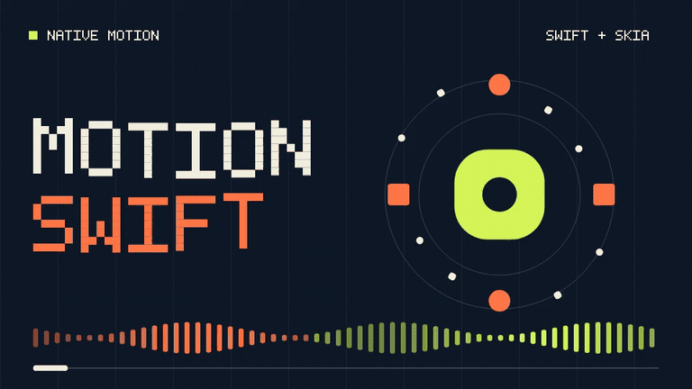
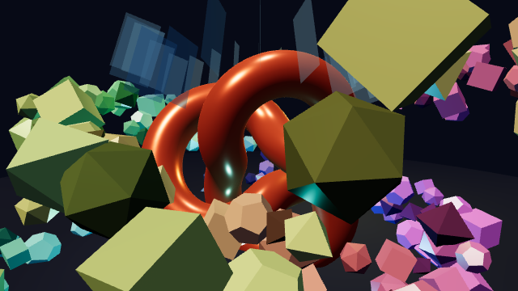
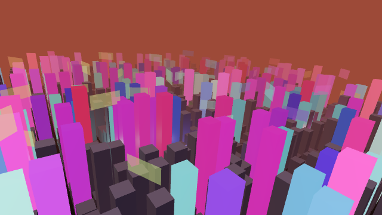
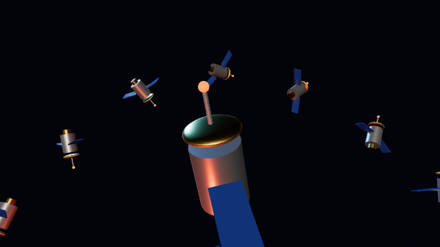

# MotionSwift

Native motion video rendering and editing with Swift + Skia.

[](docs/images/rendering/motionswift.mp4)

## Why we built MotionSwift

Remotion makes video creation through code approachable, especially with AI. Models like GPT and Claude can turn a prompt into a beautiful Remotion composition. We wanted to bring that workflow into our own Swift app.

Rendering was the painful part. Chrome and WebView added bulk, and exporting large 4K videos on a laptop took far too long. We built MotionSwift to give familiar Remotion-style compositions native rendering performance and an editor that feels at home on Apple platforms.

MotionSwift uses Skia under the hood, with Swift APIs, a SwiftUI editor, and Metal rendering with hardware video encoding on macOS. Our goal is faster exports and lower memory use while keeping motion videos editable.

We're working toward 100% compatibility with Remotion, but we're not there yet. Some APIs and styles are unsupported, and rendered output can differ. We're actively developing the framework to close those gaps. See the [current implementation](docs/current-implementation.md) and [compatibility notes](docs/compatibility.md).

## SwiftUI preview

Link the `MotionSwiftUI` package product after following the [build setup](docs/current-implementation.md#build-and-commands). This macOS example previews a composition from the checkout:

```swift
import MotionSwiftUI
import SwiftUI

struct VideoPreview: View {
    let repository = URL(fileURLWithPath: "/path/to/MotionSwift")

    var body: some View {
        MotionCompositionView(
            source: .project(
                repository: repository,
                project: repository.appendingPathComponent("Examples/ReadmeMotion"),
                entry: "src/index.tsx"
            ),
            compositionID: "ReadmeMotion",
            showsControls: true
        )
    }
}
```

## Render

Export a silent H.264 video on macOS using Metal and shared IOSurface buffers with VideoToolbox. Call this function on a background worker; the output directory must exist.

```swift
import Foundation
import MotionCompiler
import MotionRuntime
import MotionRender
import MotionEncode

func renderGPUVideo(repository: URL, output: URL) throws {
    let bundle = try Compiler(repository: repository).compile(
        project: repository.appendingPathComponent("Examples/ReadmeMotion"),
        entry: "src/index.tsx")
    let runtime = try Runtime(bundle: bundle)
    guard let composition = try runtime.compositions().first(where: {
        $0.id == "ReadmeMotion"
    }) else { throw CocoaError(.fileReadCorruptFile) }

    let options = PipelineOptions(workers: 2, backend: .gpu, sharedVideoFrames: true)
    let size = try Renderer.pixelSize(
        width: composition.width, height: composition.height, scale: options.scale)
    let stream = try SharedVideoStream(
        output: output, width: size.width, height: size.height, fps: composition.fps)
    do {
        try FramePipeline.run(
            bundle: bundle, composition: composition,
            frames: Array(0..<composition.durationInFrames), props: "{}", options: options
        ) { frame in
            guard let videoFrame = frame.videoFrame else {
                throw CocoaError(.fileReadCorruptFile)
            }
            try stream.write(videoFrame.pixelBuffer)
        }
        try stream.finish()
    } catch {
        stream.cancel()
        throw error
    }
}

// From a background worker, using your checkout path:
// try renderGPUVideo(repository: URL(fileURLWithPath: "/path/to/MotionSwift"),
//                    output: URL(fileURLWithPath: "/tmp/motion-sdk.mp4"))
```

Or render from the command line after `make bootstrap && make build`:

```sh
.build/release/motionswift render --project Examples/ReadmeMotion --entry src/index.tsx \
  ReadmeMotion /tmp/motion.mp4 --backend=gpu --encoder=videotoolbox-shared --concurrency=2
```

## Performance compared with Remotion

MotionSwift exported **17.24× faster with Metal + x264** and **18.89× faster with CPU + x264** across 12 short synthetic cases (geometric means).

| Measurement | Remotion | MotionSwift | Improvement |
|---|---:|---:|---:|
| 720p boxes, 30 frames: CPU + x264 export | 9.248 s | 0.409 s | 22.63× faster |
| 720p boxes, 30 frames: Metal + x264 export | 9.248 s | 0.421 s | 21.97× faster |
| 720p boxes, 30 frames: Metal + shared IOSurface / VideoToolbox export | 9.248 s | 0.459 s | 20.15× faster |
| Same boxes clip: peak process-tree RSS, shared IOSurface path | 2,520.2 MiB | 255.5 MiB | 89.9% lower |

Measured on an Apple M4 Max (16 cores, 128 GB), eight workers per engine, one run without warmup. Export times include startup, compilation/bundling and encoding. All cases passed SSIM ≥ 0.98; hardware/software quality settings differ. These short synthetic results do not establish full-film or 4K speedups over Remotion. RSS is sampled and excludes separate GPU/media-engine accounting.

[Comparison results and reproduction](docs/benchmarks/2026-11-12-remotion-comparison.md) · [Memory measurements](docs/benchmarks/2026-11-12-memory.md).

### 3D scenes with three.js and USDZ

`@remotion/three` compositions render natively. `<ThreeCanvas>` scenes written with React Three Fiber elements run through a Metal port of three.js's shading. The scenes can use keyframed cameras, moving and rotating meshes, animated lights, fog, transparency and USDZ models loaded with `useLoader(USDLoader, staticFile(...))`. On three complex test scenes (up to 1,200+ meshes and a 13× instanced USDZ model), native export was **11.5× faster than Remotion** (geometric mean, 360p and 1080p). Still frames stay within a PSNR ≥ 48 dB gate of Remotion's three.js output.

| Crystal Orbit | Neon City | Probe Fleet (USDZ) |
|---|---|---|
|  |  |  |

The showcase's **3D Scenes** page plays all of them live (`MOTIONSWIFT_SHOWCASE_START=3d make showcase`). See [3D support](docs/three-d.md) for the API subset and the [3D benchmark](docs/benchmarks/2026-11-13-three.md).

### Compose smaller clips with media

The showcase's **Media Composition** page opens a 24-second master containing reusable montage,
image and video compositions. Double-click a nested composition on the canvas or timeline to
open it; return through the breadcrumbs with the parent's playhead preserved. Playback controls,
mute, a scrubbable multitrack timeline, and an export sheet follow the selected composition. See [nested clips and media](docs/media-compositions.md) for the supported APIs and limits.

The macOS showcase can also be packaged as a standalone app with `make showcase-app`.
Published releases build a Developer ID signed, notarized DMG once the required credentials are
configured. See [showcase release setup and icon source](docs/showcase-release.md).

## License

MotionSwift's original source code is available under the [MIT License](LICENSE).
Third-party dependencies and bundled tools retain their own licenses; the MIT
License does not replace their license terms or notices.
