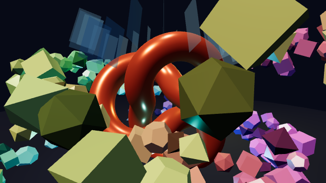

# 3D: `@remotion/three`, React Three Fiber and USDZ

MotionSwift renders `<ThreeCanvas>` scenes written for Remotion with a native Metal renderer. The same source renders in Remotion (three.js in Chrome) and in MotionSwift. No browser or WebGL runs on the native side. The renderer ports three.js r187's `WebGLRenderer` shading, so native output closely matches Remotion's three.js output (see [Regression gates](#regression-gates)).



## Writing a scene

```tsx
import {useLayoutEffect} from 'react';
import {AbsoluteFill, interpolate, staticFile, useCurrentFrame, useVideoConfig} from 'remotion';
import {ThreeCanvas} from '@remotion/three';
import {useLoader, useThree} from '@react-three/fiber';
import {USDLoader} from 'three/addons/loaders/USDLoader.js';
import {Color, DoubleSide} from 'three';

// Keyframe the default camera: position, look-at target and field of view.
const Camera = ({frame}: {frame: number}) => {
  const camera = useThree(state => state.camera);
  useLayoutEffect(() => {
    camera.position.set(interpolate(frame, [0, 90], [-6, 6]), 3, 8);
    camera.lookAt(0, 0, 0);
    camera.fov = interpolate(frame, [0, 90], [50, 35]);
    camera.updateProjectionMatrix();
  }, [camera, frame]);
  return null;
};

const Probe = ({frame}: {frame: number}) => {
  const model = useLoader(USDLoader, staticFile('models/probe.usdz'));
  return <primitive object={model} rotation={[0, frame * 0.04, 0]} />;
};

export const Scene = () => {
  const frame = useCurrentFrame();
  const {width, height} = useVideoConfig();
  return <AbsoluteFill style={{backgroundColor: '#000'}}>
    <ThreeCanvas width={width} height={height}>
      <Camera frame={frame} />
      <color attach="background" args={['#070a16']} />
      <fog attach="fog" args={['#070a16', 8, 30]} />
      <ambientLight intensity={0.3} />
      <directionalLight position={[4, 6, 5]} intensity={interpolate(frame, [0, 90], [0.5, 3])} />
      <pointLight position={[Math.cos(frame / 10) * 4, 2, 0]} intensity={30} color={new Color().setHSL(frame / 90, 1, 0.6)} />
      <mesh position={[0, -1.5, 0]} rotation={[frame * 0.02, frame * 0.03, 0]}>
        <torusKnotGeometry args={[1, 0.3, 200, 24]} />
        <meshPhysicalMaterial color="#ff6a3d" roughness={0.25} metalness={0.6} side={DoubleSide} />
      </mesh>
      <Probe frame={frame} />
    </ThreeCanvas>
  </AbsoluteFill>;
};
```

Drive all animation from `useCurrentFrame()`. Every frame is evaluated independently in a fresh React tree, as in a parallel Remotion render. Set the camera every frame in `useLayoutEffect`; values set in an earlier frame do not carry over.

## Supported API

| Area | Supported | Notes |
|---|---|---|
| `@remotion/three` | `ThreeCanvas` (`width`, `height`, `style`, `camera`, `flat`, `dpr`, `onCreated`) | `shadows`, `orthographic`, `linear`, `legacy`, `scene` and custom `gl` are rejected. `useVideoTexture`/`useOffthreadVideoTexture` are not available yet. |
| `@react-three/fiber` | `useThree` (camera, size, viewport, `set`), `useLoader(USDLoader, url)` | `useFrame` throws: animate from `useCurrentFrame()`. `Canvas`, `extend` and `createRoot` are not available. |
| Camera | Default `PerspectiveCamera`: `position`, `rotation`, `quaternion`, `up`, `lookAt()`, `fov`, `near`, `far`, `zoom`, `aspect` | `<perspectiveCamera>` elements are rejected by the compiler with a hint to use `useThree`. The projection is derived from the current fields, so `updateProjectionMatrix()` is optional. |
| Objects | `group`, `object3D`, `mesh`, `primitive` (USD models) | `position`, `rotation`, `quaternion`, `scale`, pierced props such as `position-x`/`rotation-y`, `visible`, `renderOrder`. Event handlers are ignored. |
| Geometry | `box`, `sphere`, `plane`, `cylinder`, `cone`, `torus`, `torusKnot`, `circle`, `ring`, `icosahedron`, `octahedron`, `tetrahedron`, `dodecahedron` (`…Geometry` with `args`) | Generated natively. Buffers are bit-identical to three.js r187 (`tests/three/geometry-hashes.json`). |
| Materials | `meshBasicMaterial`, `meshLambertMaterial`, `meshPhongMaterial`, `meshStandardMaterial`, `meshPhysicalMaterial`, `meshNormalMaterial` | `color`, `emissive`, `emissiveIntensity`, `roughness`, `metalness`, `ior`, `specular`, `shininess`, `opacity`, `transparent`, `side` (`FrontSide`/`BackSide`/`DoubleSide`), `flatShading`, `toneMapped`, `depthTest`, `depthWrite`, `fog`, `visible`. Textures (`map`, …), `wireframe`, `vertexColors`, clearcoat, sheen, transmission and environment maps are rejected. |
| Lights | `ambientLight`, `hemisphereLight`, `directionalLight`, `pointLight` (`distance`, `decay`), `spotLight` (`angle`, `penumbra`, `distance`, `decay`) | Physical light units as in three.js r155+. Directional and spot lights aim at the origin; `target` is rejected. No shadows. |
| Scene | `<color attach="background">`, `<fog attach="fog">`, `<fogExp2 attach="fog">` | |
| `three` | `Color` (CSS names, hex, `rgb()`, `hsl()`, `setHSL`, `lerp`…), `Vector2/3`, `Euler`, `Quaternion`, `MathUtils`, side and color-space constants | A math subset with three.js's float64 operation order. Rendering classes are not provided; use JSX elements. |
| Models | `useLoader(USDLoader \| USDZLoader, url)` + `<primitive object={model}>`, `model.clone()` | USD, USDA, USDC and USDZ files, loaded natively by ModelIO. Meshes must be triangulated. UsdPreviewSurface `diffuseColor`, `emissiveColor`, `roughness`, `metallic` and `opacity` map to physical materials with linear colors, as in three.js's `USDLoader`. Textures, skinning, animation and `metersPerUnit`/`upAxis` conversion are not supported yet. |
| Assets | `staticFile('models/x.usdz')` | Resolved against the project's `public/` folder. The CLI and `MotionPlayer` set this folder when they open a project (`MediaSource.publicDirectory`). |

Unsupported elements and properties fail with an error naming them. Nothing is silently skipped.

## How it renders

1. In JavaScriptCore, `ThreeCanvas` renders an `ms-three` host node, and R3F elements commit as ordinary host nodes beneath it. At commit, the canvas serializes its subtree into one scene description (`Scene3D`). The description holds resolved defaults, linear colors and quaternions computed with three.js's math. It replaces layout children, so 3D nodes never reach Yoga.
2. The painter asks `SceneRenderer3D` (one per render worker) for the canvas pixels. It reproduces `WebGLRenderer` behavior:
   - It uses three.js matrix arithmetic in float64, uploaded as float32.
   - Opaque objects are sorted by render order, material and depth. Transparent objects are sorted back to front, with double-sided transparent meshes drawn in two passes.
   - Lights are transformed into view space.
   - Rendering uses MSAA ×4 into an 8-bit target with depth LessEqual and three's blend functions.
   - Shaders are a Metal port of the r187 chunks, including the GGX/DFG LUT multiscattering, Blinn-Phong, ACES filmic tone mapping, the sRGB transfer function and fog.
   - The frame is drawn bottom-up like ANGLE's default framebuffer, so MSAA sample positions match Chrome.
3. A blit copies the resolved frame into a shared buffer. It is composited as a premultiplied image by the CPU or Metal Skia backend; both give identical pixels. The canvas size is CSS size × the render scale, clamped to R3F's `dpr` range (default `[1, 2]`), as in Remotion.

3D always uses Metal, including with `--backend=cpu`. Linux and non-Metal targets cannot render `ThreeCanvas` yet.

## Regression gates

The fixtures live in `tests/three` (`src/scenes`, `public/models/probe.usdz` and generators in `tools/`):

| Fixture | What it stresses |
|---|---|
| `CrystalOrbit` | Keyframed camera (position, target, fov, roll); a 220×28 torus knot; 192 animated crystals across 4 materials; 24 transparent double-sided panes; 6 lights including an animated spotlight; linear fog |
| `NeonCity` | 1,156 towers (1,200+ meshes); a banking flythrough; exponential fog and sky color animation; 6 moving point lights; 40 translucent billboards |
| `ProbeFleet` | Binary USDZ model instanced 13 times; tumbling copies; three-point lighting that changes over time |
| `GeometryLab` | Every geometry × material pair, double/back sides and flat shading |

- `make three-visual` renders 17 frames natively with each Skia backend and compares them with reviewed Remotion references in `tests/golden/three` (Chrome ANGLE/Metal, `gl: 'angle'`). Each frame must be bit-identical when rendered twice. Against Remotion, each frame may have at most **4%** changed pixels and at most **0.3%** of pixels more than 8 levels off, with PSNR of at least **48 dB**. Interiors match exactly. Sub-pixel edges and derivative-based flat normals can round differently between ANGLE's translated GLSL and the Metal port. References are pinned to the Remotion, `@remotion/three`, three.js, R3F and Chrome versions, the GL option, the fixture manifest and a hash of `src/`, `public/` and `tools/`. Run `make three-goldens` after an intentional change, then review the results.
- `make three-benchmark` (`tests/perf/three.mjs`) renders each scene to H.264 at 360p and 1080p. It runs Remotion `renderMedia()` and native CPU, Metal and shared-IOSurface/VideoToolbox renders, eight workers each. Native videos must match Remotion's frame count and dimensions with SSIM ≥ 0.97, and every native engine must be faster than Remotion. Results appear in the PR benchmark comment ([latest numbers](benchmarks/2026-11-13-three.md)).
- Swift tests (`tests/Swift/Scene3DTests.swift`) check geometry buffer parity with three.js, scene serialization through the portable compiler, determinism and CPU/GPU equality, dpr clamping, USDZ loading and error messages. Node tests (`tests/tools/three.test.mjs`) check the shim's color, Euler and look-at math against three.js, the serialized defaults, rejected features, the gate metric and typings.
